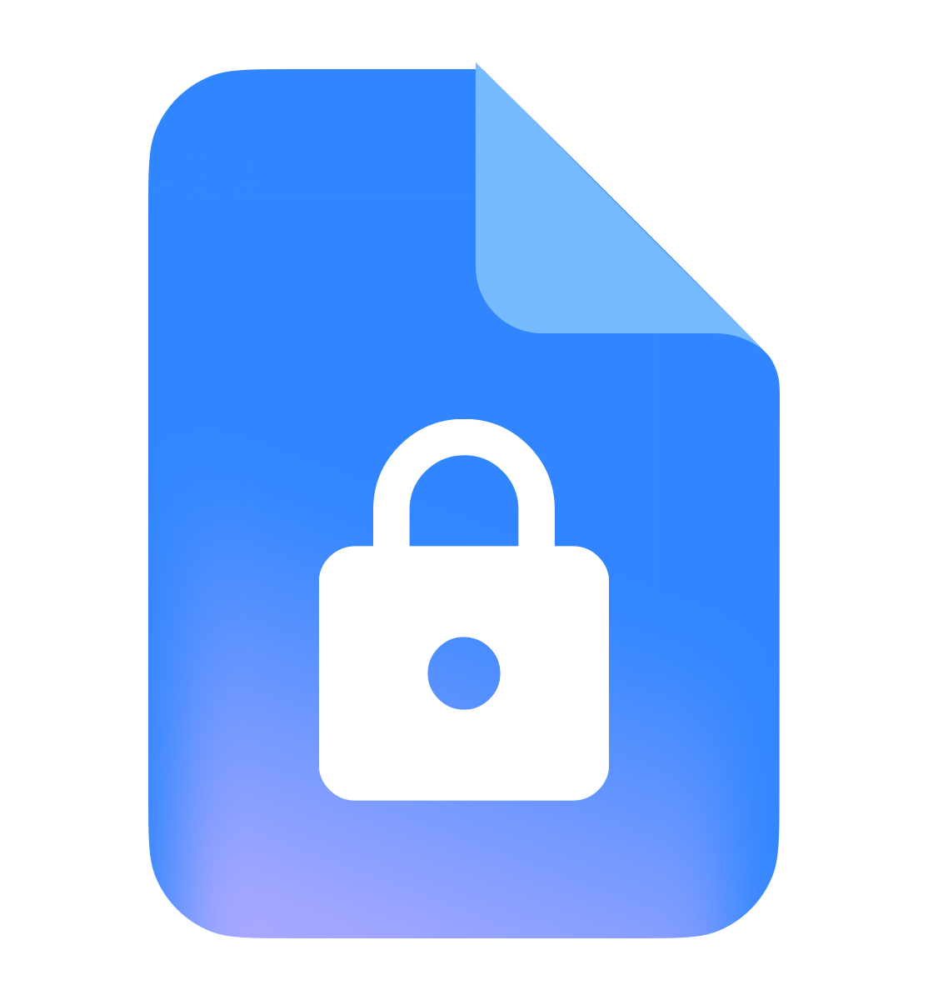
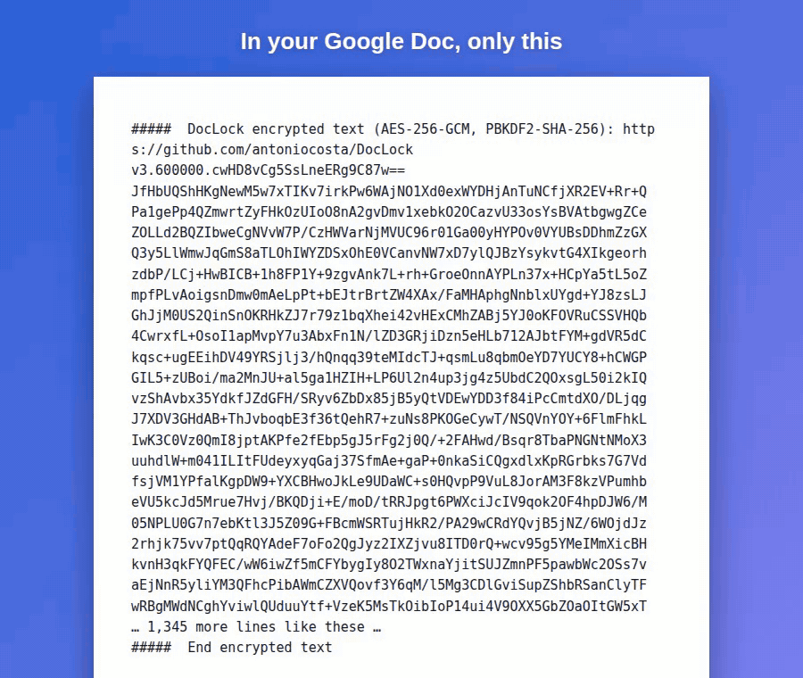
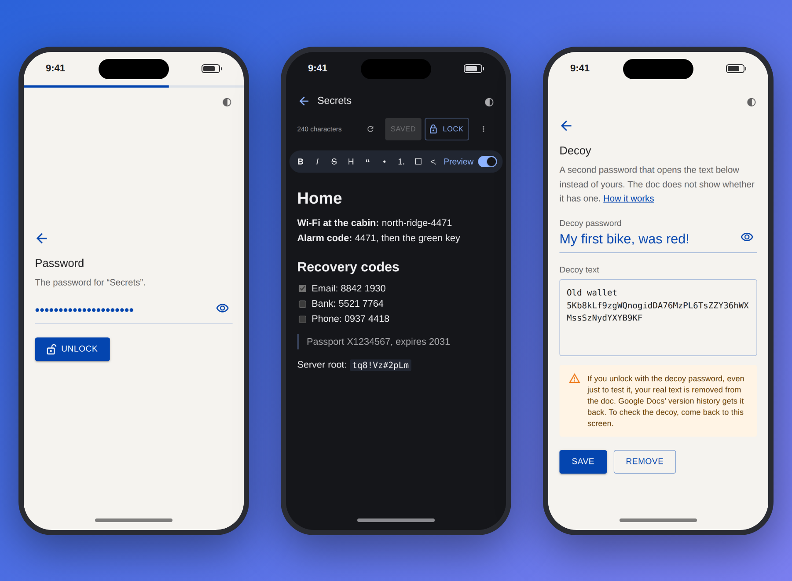

<p align="center"></p>

<h1 align="center">DocLock</h1>

<h3 align="center">Strongly encrypted text in your own Google Docs. Free, in any browser.</h3>

<p align="center">With an optional <a href="docs/decoy.md">decoy password</a> for the day someone forces you to unlock (<a href="https://en.wikipedia.org/wiki/Deniable_encryption">plausible deniability</a>, <a href="docs/decoy.md#what-it-cannot-do">with limits</a>).</p>

<p align="center"></p>

DocLock keeps secret text (passwords, PINs, recovery codes, private notes)
in a Google Doc, encrypted. You open the doc in DocLock, type its password
and edit the text. Saving encrypts it again in your browser and writes it
back. The doc itself only ever holds unreadable ciphertext.

<p align="center"></p>

If you like this or find it useful, support the project by buying me a coffee.

<a href="https://www.buymeacoffee.com/antoniocosta"></a>

**Contents:**

[Why?](#why) · [Can I trust it?](#can-i-trust-it) ·
[Install](#install) · [Using DocLock](#using-doclock) ·
[Choosing a good password](#choosing-a-good-password) ·
[Security](#security) · [Technical details](#technical-details) ·
[Development](#development) · [License](#license)

## Why?

I have kept my secrets in a plain doc for many years: Passwords, PINs,
recovery codes. I could never quite trust a dedicated cloud service with
that sort of thing, and I always thought a plain, simple doc should be
enough, as long as nobody but me can read it.

All that time I encrypted it with
[JavaScrypt](https://www.fourmilab.ch/javascrypt/) (spelled with a "y"),
the classic public-domain cryptography page that Autodesk founder John
Walker published in 2005 on his website, Fourmilab. It runs entirely in
the browser and sends nothing anywhere, which is exactly what I wanted.
Thank you, [John (1949–2024)](https://en.wikipedia.org/wiki/John_Walker_(programmer)).

DocLock is the same idea, brought up to date. The encryption is now
AES-256-GCM, with the key derived by PBKDF2-SHA-256 at 600,000 iterations,
the number
[OWASP recommends](https://cheatsheetseries.owasp.org/cheatsheets/Password_Storage_Cheat_Sheet.html#pbkdf2)
and [Bitwarden's default](https://bitwarden.com/help/kdf-algorithms/),
all through the browser's own Web Crypto. And it is far more convenient:
It opens the doc, lets me edit the text and saves it back encrypted. These
days it is much easier to build your own polished tools, and to share them
with others too. So here it is.

**It keeps your text in a cloud you already have, your Google account**,
not in a password manager's vault. Password managers and secure-notes apps such as
[1Password](https://1password.com/pricing/password-manager),
[LastPass](https://www.lastpass.com/pricing) and
[Dashlane](https://www.dashlane.com/pricing) follow a different
philosophy: They keep your secrets in their cloud, for a subscription. For
one person that is about $36 a year for LastPass, $48 for 1Password and
$60 for Dashlane (regular prices, billed yearly, as of November 2026).
Some have free plans too, but your vault still lives on their servers.
**DocLock is free and open source, and you can host it yourself at no
cost.**

**There is also no company holding everyone's vaults in one database.** When
[LastPass was breached in 2022](https://en.wikipedia.org/wiki/LastPass#2022_customer_data_and_partially-encrypted_vault_theft),
attackers copied its customers' vaults, partly encrypted, in one go. With
DocLock, an attacker has to get your encrypted doc first (from your own
Google account, or from your device), and then still guess that doc's
DocLock password.

**It is not a password manager**: No autofill, no sharing, no browser
extension. It is a safe place for text, with simple
[Markdown](https://www.markdownguide.org/basic-syntax/) formatting.

I think the design is solid but
[it has not been audited](#has-it-been-audited). Reviews and suggestions
are most welcome.

## Can I trust it?

### Can Google read my secrets?

**No.** DocLock encrypts your text on your device before anything is sent.
Google only receives and stores a block of random-looking characters, like
the one you can see in the animation above. Of your secrets, that is all
Google's systems, its scanning, its AI features and its staff can see, and
all Google could hand over to any legal authority that forces it to. Your
password is never sent to Google either. They couldn't see your text even
if they wanted to.

Google does see the doc's title, anything you type outside the encrypted
block, and when you unlocked or saved. Keep secrets out of those.

### Can the DocLock author see them?

**No.** There is no DocLock server and no DocLock account. You run your own
copy, connected to your own Google project, so nothing ever passes through
the DocLock author. I couldn't see your text even if I wanted to.

### What if someone gets into my Google account?

They find the same random-looking block of text. To read it, they would
still need that doc's DocLock password.

### What if I forget the password?

Then nobody can recover the text, not even you! There is no reset and no
back door, and that is exactly what keeps it safe. Store the password where
you won't lose it.

### Why does setup take about 10 minutes?

Because you create your own private connection to Google instead of using
someone else's. After this one-time step, nothing passes through the
DocLock author or any shared service. You still rely on the host you
choose to serve the files unchanged, and on your browser. A guide in the
app walks you through it. See [Install](#install).

### Can I check all this myself?

Yes, all the code is here and fully auditable: About 2,400 lines of plain
HTML, CSS and JavaScript in [`app/`](app/), with no libraries and no build
step, so what you read is exactly what runs in your browser. The encryption
is in [`app/cipher.js`](app/cipher.js) (about 170 lines). Your browser's
[developer tools](https://developer.chrome.com/docs/devtools/network) show
every network request: Only your own host (the app's files), Google's
sign-in and profile, and its Docs and Drive APIs to read and save
encrypted text. Nothing else.

### Has it been audited?

No. DocLock is one person's project and has had no independent security
audit. It is small enough to read in full, and the encryption uses only
the browser's built-in Web Crypto. Judge it yourself before you trust it
with anything important.

### What if DocLock disappears?

Your text stays readable. The format is documented and uses standard
algorithms, and [a few lines of Python](#technical-details) decrypt a doc
without DocLock.

## Install

There is no shared DocLock service, on purpose: You host your own copy and
connect it to your own free Google Cloud project. You need a static HTTPS
host (free ones work) and a Google account. About 10 minutes, once.

1. **Host the [`app/`](app/) folder** over HTTPS on any static host
   (GitHub Pages, Cloudflare Pages, Netlify, your own server), at the root
   or in a subfolder such as `https://example.com/doclock/`.
2. **Open it and click Set up.** A guide takes you through Google Cloud one
   step at a time, with direct links and the exact addresses to paste. It
   ends by making your `config.js`.
3. **Upload `config.js`** next to `index.html`. DocLock checks it and is
   ready.

On your first sign-in, Google says it
[hasn't verified the app](https://support.google.com/cloud/answer/7454865)
(it is yours, not a published one); choose **Continue**.

**Install it as an app (optional).** In Chrome, Edge and Safari, or
Firefox on Android:
[Add it to your home screen or install it](https://developer.mozilla.org/en-US/docs/Web/Progressive_web_apps/Guides/Installing)
from the browser's menu, and it opens in its own window.

<details>
<summary>Why your own copy, and not a shared one?</summary>

- **You run code you can read.** A web page can only be as trustworthy as
  whoever serves it, because they could change the code at any time. With
  your own copy, that is you.
- **Nobody else handles your sign-in.** Sign-ins go to your Google project, not
  to one owned by the DocLock author or anyone else.
- **Only you can sign in.** The project stays in
  [Testing mode](https://support.google.com/cloud/answer/15549945), which
  only lets in the test users you list: Your account.

A shared copy could also keep your text encrypted, but you would have to
take its host's word for it. Your own copy removes that doubt.

</details>

<details>
<summary>On one computer only, without a host</summary>

Serve `app/` at `http://localhost:8080` (for example with
`python3 dev/serve.py`) and follow the guide there. Google accepts plain
`http` only on `localhost`.

</details>

<details>
<summary>Manual setup, without the guide</summary>

In the [Google Cloud console](https://console.cloud.google.com/):

1. Create a project.
2. **APIs & Services → Library**: Enable the **Google Docs API** and the
   **Google Drive API**.
3. **Google Auth Platform → Branding**: Click **Get started**. App name,
   support email, audience **External**.
4. **Google Auth Platform → Audience**: Under **Test users**, add your
   Google account.
5. **Google Auth Platform → Clients → Create client**: Type **Web
   application**.
   - **Authorized JavaScript origins**: Your site, e.g.
     `https://example.com`
   - **Authorized redirect URIs**: The app's folder +
     `oauth-callback.html`, e.g.
     `https://example.com/doclock/oauth-callback.html`
6. Copy the **Client ID** (ignore the Client secret; DocLock doesn't use
   it), then `cp app/config.example.js app/config.js` and paste it in.

The Client ID is
[public by design](https://developers.google.com/identity/protocols/oauth2/javascript-implicit-flow):
It appears in every Google sign-in, and Google only sends sign-ins to the
addresses you registered. `app/config.js` is git-ignored.

DocLock asks Google for your basic profile (name, email, photo), access to
Google Docs (Google's permission covers all your Docs; DocLock only opens
the ones you give it), and Drive access only to files it created (the DocLock folder and new docs): The `SCOPES` in
[`app/gdocs.js`](app/gdocs.js).

</details>

<details>
<summary>Hosting notes</summary>

- **Give DocLock its own origin** (e.g. `https://doclock.example.com/`),
  if you can. Browsers keep a site's storage per origin, not per folder, so
  any other page on the same origin could read DocLock's stored data and
  open it in a frame.
- Add `?setup` to the address to see the guide on a copy that is already
  set up, and `?setup#3` to open step 3. Your `config.js` is left alone.
- On Cloudflare, Web Analytics injects a script into pages. DocLock's
  Content Security Policy blocks it; to stop the injection, add a
  `_headers` file at the site's root, with the path to your DocLock folder:

  ```
  /doclock/*
    Cache-Control: public, max-age=0, must-revalidate, no-transform
    X-Frame-Options: DENY
    Content-Security-Policy: frame-ancestors 'none'
  ```

  The last two lines stop other sites from framing DocLock (other hosts:
  Send the same two headers). DocLock also refuses to show itself in
  another site's frame.

- Updates: The service worker fetches the newest files whenever the server
  can be reached, and uses its cached copy of the app's own files only
  offline. It never handles requests to Google.

</details>

## Using DocLock

1. **Sign in with Google.**
2. **Paste a Google Doc link**, or create a new doc. New docs go into a
   "DocLock" folder in your Drive.
3. **Type that doc's password.** Each doc has its own.
4. **Edit, then Save.** The button shows **Saved** when there is nothing
   left to save.
5. **Lock** when you are done. Leaving the page locks it too.

The **⋮** menu in the editor changes the doc's password and sets its
[decoy](docs/decoy.md).

- **Markdown.** Format with the bar (bold, italic, strikethrough,
  headings, quotes, lists, checklists, code, links) or type
  [Markdown](https://www.markdownguide.org/basic-syntax/) yourself;
  **Preview** shows it formatted. It is saved as plain text inside the
  encryption. See [what Preview supports](#technical-details).
- **Built not to lose text.** Every save is checked before and after it is
  written, the previous version is kept in your browser (a password that
  only opens that one is offered it back), and a doc
  whose text changed on another device is never overwritten: You see both
  versions and choose. Unsaved edits survive a crash as an encrypted draft (not in
  a doc with a decoy).
- **A decoy, if you want one.** A second password that opens a harmless
  text instead of yours, for the day someone forces you to unlock. The doc
  does not show whether it has one. Never unlock with it to test: That removes your
  real text from the doc
  ([how to get it back](docs/decoy.md#getting-your-text-back)). If someone
  who knows the decoy password changes the doc with a tool of their own to
  find out, DocLock opens it read-only and writes nothing
  ([why](docs/decoy.md#if-someone-tampers-with-the-doc)). Read
  [The decoy](docs/decoy.md) first: How it works, [what it costs](docs/decoy.md#what-it-costs),
  its limits, and [the law](docs/decoy.md#the-law-and-your-responsibility).
- **The rest of the doc is yours.** DocLock changes only the encrypted
  block, so the doc can hold other text around it.
- **One size, and a limit.** The block is always about 89,000 characters,
  roughly 30 pages in Google Docs, whatever it holds. It takes about
  40,000 characters of random letters and digits, or about 75,000 of
  ordinary writing, less whatever a decoy takes; the editor shows when a
  doc is nearly full.
- **Phones, tablets and computers**, in any browser from 2023 on: It needs
  [Web Crypto](https://caniuse.com/cryptography) and
  [Compression Streams](https://caniuse.com/mdn-api_compressionstream).
- **A link to a tab opens that tab**, in docs that have several.

## Choosing a good password

A good password is long, unpredictable and memorable. Attackers don't try
every combination blindly: They start with
[dictionaries](https://en.wikipedia.org/wiki/Dictionary_attack), famous
phrases and common patterns. What counts is how much of the password is
truly unpredictable, not how complicated it looks. DocLock asks for at
least 8 characters, and warns below 12.

**Best: Random words with a story.**

Let chance pick 6 words: Roll dice with a
[Diceware word list](https://www.eff.org/dice) or use a generator you
trust, and keep the words you get, even odd ones. Then picture a scene that
links them. `tundra lantern velvet bishop orbit pickle`: A bishop in velvet
carries a lantern across the tundra while a pickle orbits overhead. 100,000
GPUs would need about 2 million years (see the
[table](#what-it-cannot-protect-against)).

**Good: A long sentence only you would say.**

Something true and personal that you have never written down or posted,
punctuation included: `My 1st bike was a red Peugeot, and I rode it into
Mr. Lima's hedge!` A long, unusual sentence is far beyond guessing. Avoid
famous quotes, proverbs, song lyrics and film lines: Attackers have lists
of them.

**Weak, even if it looks strong:**

- Words or names with numbers and symbols added, such as
  `Lisbon-1987-$$$$-Benfica`. Repeated or sequential characters (`$$$$`,
  `12345`) and personal facts (birth years, teams, pets) are among the
  first things cracking tools try
  ([rule-based attacks](https://hashcat.net/wiki/doku.php?id=rule_based_attack)).
- Letters swapped for look-alikes, such as `P@ssw0rd`.
- A password you use anywhere else. Passwords leaked from other sites are
  tried first ([credential stuffing](https://en.wikipedia.org/wiki/Credential_stuffing)).

Don't use the examples above; make your own.

**Keep a copy on paper.**

A forgotten password means lost text. Written down once and kept somewhere
safe at home, it is out of reach of anyone online, and far safer than a
short password you might forget.

## Security

- **Encrypted in your browser.** Text is encrypted and decrypted on your
  device with the browser's built-in
  [Web Crypto](https://developer.mozilla.org/en-US/docs/Web/API/Web_Crypto_API):
  [AES-256-GCM](https://en.wikipedia.org/wiki/Galois/Counter_Mode), with
  the key derived from your password by
  [PBKDF2](https://en.wikipedia.org/wiki/PBKDF2)-SHA-256 (600,000
  iterations, random salt), all in [`app/cipher.js`](app/cipher.js). GCM
  is [authenticated encryption](https://en.wikipedia.org/wiki/Authenticated_encryption):
  Any change to the part your password opens is detected. The other half
  of the block is not checked (see
  [the decoy's limits](docs/decoy.md#what-it-cannot-do)).
- **Google never sees your text or your password.** It stores only the
  ciphertext (and the doc's title, which is not encrypted). Neither Google nor anyone else can read it without the
  password.
- **Two locks.** To read your text, someone needs the encrypted text, which
  means your Google sign-in (including its
  [2-step verification](https://support.google.com/accounts/answer/185839),
  if on) or this device, and that doc's DocLock password.
- **Your password is never kept.** DocLock clears it from the page as soon
  as the doc is unlocked (`clearPasswords()` in [`app/ui.js`](app/ui.js))
  and never stores it. Only a key derived from it stays in memory while the
  doc is open, created
  [non-extractable](https://developer.mozilla.org/en-US/docs/Web/API/CryptoKey/extractable),
  so the page itself can't read that key out. The password fields ask the
  browser not to save the password (`autocomplete="off"` in
  [`app/index.html`](app/index.html)); if your browser offers to anyway,
  choose **Never**. A [decoy](docs/decoy.md) is the exception: Its password
  and key are stored inside your encrypted text, so that every save can
  rewrite the decoy, and they are in the page while your text is open.
- **One password per doc.** Use different ones, and a leaked password
  opens only its own doc.
- **Nothing else leaves your device.** The only network traffic is the app's
  own files, Google sign-in (with your name and photo), and the Docs and
  Drive calls that create, read and write the encrypted doc
  ([`app/gdocs.js`](app/gdocs.js)). There is no DocLock server, no
  analytics and no third-party code, and the page's
  [Content Security Policy](https://developer.mozilla.org/en-US/docs/Web/HTTP/CSP)
  (the `Content-Security-Policy` `<meta>` in
  [`app/index.html`](app/index.html)) blocks scripts, styles and requests
  to anywhere else. The allowed list is in that tag.
- **Decrypted text is never stored.** DocLock keeps it only in the open
  page: Never in browser storage or the browser's cache, and the editor
  asks the browser not to spell-check or autofill it (the editor's `spellcheck="false" autocomplete="off"` in
  [`app/index.html`](app/index.html)). Lock or close the page and it is
  gone (`forget()` in [`app/app.js`](app/app.js)). Unsaved edits are kept
  only as an encrypted draft (`saveDraft()`).
- **The doc does not show what is in it.** Every doc is the same size and
  is rewritten whole, freshly encrypted, on every save and on every unlock
  that can reach the doc. Its length says nothing of how much you wrote,
  and no version shows whether it has a [decoy](docs/decoy.md). A long
  history can still hint at one: See [its limits](docs/decoy.md#what-it-cannot-do).
- **No DocLock middleman.** You run your own copy with your own Google
  project. Your host still serves the code: See below.
- **Lost password, lost text.** There is no reset and no recovery, by
  design. Keep the password somewhere safe.

### What it cannot protect against

**Weak passwords.** Someone who already has the encrypted text (from your
Google account, or from the versions kept in your browser) can try
passwords on their own computers.

DocLock makes every guess deliberately slow (600,000 rounds of
PBKDF2-SHA-256): One top gaming graphics card (an RTX 4090) manages only
about 15,000 guesses per second
([benchmark](https://gist.github.com/Chick3nman/32e662a5bb63bc4f51b847bb422222fd):
8.87 million per second at 999 rounds, so about 14,800 at 600,000).

A big AI data centre has 100,000 GPUs or more
([xAI's Colossus](https://en.wikipedia.org/wiki/Colossus_(data_center))
started with about 100,000 Nvidia H100s in 2024 and has grown since). The
table counts 100,000 GPUs, each as fast as an RTX 4090. That overstates a
real data centre: The same researcher measured its cards as slower at this
than the gaming card, about 8,100 guesses per second for an
[H100](https://gist.github.com/Chick3nman/e1417339accfbb0b040bcd0a0a9c6d54)
and 6,000 for an
[A100](https://gist.github.com/Chick3nman/d65bcd5c137626c0fcb05078bba9ca89)
(both the PCIe variants). The newer
[RTX 5090](https://gist.github.com/Chick3nman/09bac0775e6393468c2925c1e1363d5c)
gaming card manages about 18,600, a quarter more than the 4090. For a
password picked at random, the average time to guess it:

| Password | One graphics card | 100,000 GPUs |
|---|---|---|
| 8 lowercase letters | 82 days | 1 minute |
| 12 lowercase letters | 100,000 years | 1 year |
| 16 lowercase letters | 47 billion years | 466,000 years |
| 8 letters and digits | 230 years | 20 hours |
| 12 letters and digits | 3 billion years | 34,000 years |
| 10 keyboard characters | 64 million years | 640 years |
| 3 random words | 6 months | 3 minutes |
| 4 random words | 4,000 years | 2 weeks |
| 5 random words | 30 million years | 300 years |
| 6 random words | 236 billion years | 2 million years |

The universe is about
[14 billion years old](https://en.wikipedia.org/wiki/Age_of_the_universe).
With **6 or more random words**, or **12 or more random letters and
digits**, even 100,000 GPUs working on your password alone would
need tens of thousands to millions of years.

Words are from a 7,776-word list
([Diceware](https://en.wikipedia.org/wiki/Diceware)); "keyboard
characters" are the 95 printable ones. Each time is half the possible
passwords divided by the guessing speed. These times hold only for
passwords that are truly unpredictable. See
[Choosing a good password](#choosing-a-good-password).

**A compromised device.** Malware or a malicious browser extension on your
device can see what you see. So always be aware of what you install and
run!

**A compromised host.** Whoever serves the app's files (your static host,
or anyone who gets into it) can change the code that sees your password.
Use a host you trust, or run DocLock from your own computer.

## Technical details

<details>
<summary>The encryption format, and decrypting without DocLock</summary>

The format is documented and uses standard algorithms, so your text can be
decrypted without DocLock. A doc holds one block:

```
#####  DocLock encrypted text (AES-256-GCM, PBKDF2-SHA-256): https://github.com/antoniocosta/DocLock
v3.<iterations>.<salt>
<two slots>
#####  End encrypted text
```

`salt` (16 bytes) and the two slots (32,768 bytes each, one after the
other, wrapped at 64 characters) are standard Base64. Key =
PBKDF2-HMAC-SHA-256(password in Unicode NFC, salt, iterations, 32 bytes).

A slot is a 12-byte IV, then AES-256-GCM ciphertext with its 16-byte tag
at the end. The `v3.…` line is the GCM additional data; the first and last
lines only mark the block. Decrypted, a slot is a 4-byte length
(big-endian), then that many bytes of raw DEFLATE holding JSON
(`{"t": "your text"}`), then zeros up to the slot's size.

One slot holds your text. The other holds a [decoy](docs/decoy.md) or
random bytes, and the two come in a random order: Try your key on both.
Each save keeps the salt and draws new IVs. With Python's `cryptography`
package:

```python
import base64, hashlib, json, unicodedata, zlib
from cryptography.hazmat.primitives.ciphers.aead import AESGCM
block = open('block.txt').read()  # the block copied from the doc, ##### to #####
password = input('Password: ')
lines = [l.strip() for l in block.strip().splitlines()]
header, body = lines[1], base64.b64decode(''.join(lines[2:-1]))
_, n, salt = header.split('.')
key = hashlib.pbkdf2_hmac('sha256', unicodedata.normalize('NFC', password).encode(), base64.b64decode(salt), int(n), 32)
for slot in body[:32768], body[32768:]:
    try: plain = AESGCM(key).decrypt(slot[:12], slot[12:], header.encode())
    except Exception: continue
    print(json.loads(zlib.decompress(plain[4:4 + int.from_bytes(plain[:4], 'big')], -15))['t'])
```

Docs written before the decoy existed use an older layout (`v2.…`, one
ciphertext). DocLock still opens them and rewrites them on the first
unlock.

</details>

<details>
<summary>How a save works</summary>

All in [`app/save.js`](app/save.js):

1. Encrypt the text, decrypt it again in memory and compare. Nothing is
   written if they differ.
2. Back up the doc's previous ciphertext in the browser.
3. Replace only the encrypted block, in one atomic request that Google
   refuses if the doc changed since it was read
   ([`requiredRevisionId`](https://developers.google.com/workspace/docs/api/reference/rest/v1/documents/batchUpdate#WriteControl)).
   An edit elsewhere in the doc is retried on the new version, and so is a
   block that an unlock elsewhere only encrypted again; a change to its
   content shows both versions.
4. Read the doc back and decrypt it before saying "Saved".
5. Back up what was saved too. The browser keeps the last 20 ciphertexts
   per doc.

Unlocking a doc runs the same save once, with the text unchanged (see
[The decoy](docs/decoy.md) for why).

Unsaved edits are kept every 3 seconds as a draft, encrypted with the
doc's key, and offered back after a crash. A doc with a decoy keeps none.

</details>

<details>
<summary>Markdown: What Preview supports</summary>

Headings (`#` to `######`), paragraphs (a line break stays a line break),
`**bold**`, `_italic_`, `~~strikethrough~~`, `` `code` ``, code blocks
(` ``` `), links (`[text](https://…)` and bare `https://` addresses),
bullet and numbered lists (nested by indenting), checklists (`- [ ]`,
`- [x]`), quotes (`>`) and dividers (`---`). Not supported: Images, tables
and raw HTML.

Preview is rendered by DocLock's own small renderer,
[`app/markdown.js`](app/markdown.js), with no library. It escapes all text
before applying any formatting, so nothing typed can become HTML or a
script, and it keeps links only to `http(s)` and `mailto` addresses.
Images are left out on purpose: Loading one would tell its server when
you opened the doc. A test feeds it 100,000 random inputs and checks that
the output only ever holds these elements and safe links. The formatting
bar ([`app/format.js`](app/format.js)) only inserts Markdown characters
into the text.

</details>

<details>
<summary>What is stored where</summary>

| Where | What |
|---|---|
| Your Google Doc | The ciphertext |
| Page memory, until Lock or closing the page | Decrypted text (with a decoy's password, key and text, if it has one), the key (one the page itself cannot read out), the Google access token (at most an hour) |
| Browser storage | Recent docs (ID, tab, title), last account (name, email, photo), your view and theme choice, encrypted drafts, the last 20 ciphertext backups per doc; for this tab only: Which doc is open, and Google's sign-in answer for the moment it takes to return to the app |
| Browser cache | The app's own files, for starting offline. Never doc text |

**Forget account** on the first screen deletes everything in the "Browser
storage" row.

</details>

## Development

```sh
python3 dev/serve.py   # http://localhost:8080, serves app/ with caching off
npm test               # unit tests (Node 20+)
node dev/e2e.mjs       # clicks through every flow against a fake Google
npm run phones         # the phone picture, docs/phones.png
npm run demo           # the animation, docs/demo.gif (needs ffmpeg)
npm run pictures       # both, after any change to the UI
```

The browser scripts need the dev server running and Playwright, the only
dev dependency (`npm
install`, then `npx playwright install chromium`). The app itself has
none. The unit tests cover the encryption format, doc parsing, the
save pipeline, the Markdown renderer and sign-in. `dev/publish.sh SITE_REPO [FOLDER]` copies `app/` into a
static site's repository and commits it.

<details>
<summary>Files</summary>

| File | |
|---|---|
| `app/index.html`, `style.css` | The page and its look |
| `app/app.js` | The flows: Sign in, open, create, edit, save, lock, decoy, change password |
| `app/ui.js` | Page plumbing: Snackbar, steps, busy states, password fields |
| `app/setup.js` | The setup guide for a copy without `config.js` |
| `app/theme.js` | Applies the light or dark theme before the page draws |
| `app/config.example.js` | Template for `config.js`, which holds your Client ID and is git-ignored |
| `app/markdown.js`, `format.js` | Markdown: The Preview renderer and the formatting bar |
| `app/cipher.js` | The encryption (Web Crypto): Key derivation, sealing and opening a block, the decoy's slot |
| `app/docmodel.js` | Doc links, tabs, finding the encrypted block |
| `app/save.js` | The save pipeline |
| `app/gdocs.js` | Google sign-in and the Docs and Drive API calls |
| `app/store.js` | Recents, backups and drafts in the browser |
| `app/oauth-callback.*` | Receives Google's sign-in answer |
| `app/sw.js`, `manifest.webmanifest`, `*.png` | Installable app and offline start; `node dev/icons.mjs` makes the PNGs from `logo.svg` |

</details>

## License

DocLock is free software under the **GNU General Public License v3.0**; see
[LICENSE](LICENSE).

**Icons** are [Material Symbols](https://fonts.google.com/icons) by Google,
Apache License 2.0.
